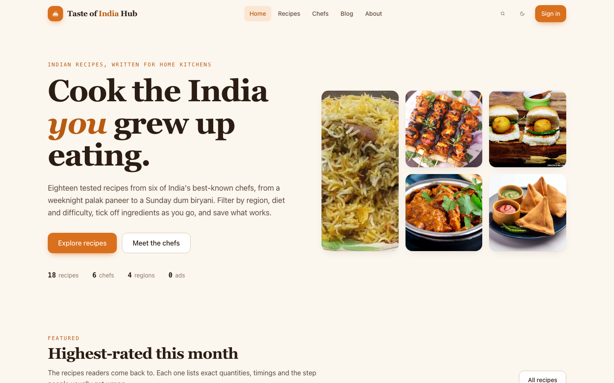

# Taste of India Hub

Indian recipes from chefs you know, written for home kitchens. Search and filter 18 fully
specified recipes from six chefs, tick off ingredients as you cook, and save favourites to an
account.

**Live demo:** https://avinash9694.github.io/TasteOfIndiaHub/



## Why I built this

The first version of this site was my 2023 React learning project: Create React App, SCSS and a
tiny Express server that the client could not work without. I rebuilt it from scratch to the
standard I hold production work to: typed data with runtime validation, a bundled-first data
layer that survives the API going away, a real design system with light and dark themes, and a
test suite that runs on every push. The content is the same; everything around it is new.

## Features

- **Recipe browser** with full-text search across names, ingredients, chefs and tags, plus
  facets for chef, region, diet and difficulty derived from the data. Filters live in the URL
  so a search is shareable.
- **Recipe pages** with exact quantities, a checkable ingredient list that remembers progress
  per recipe, numbered method steps, timings, servings, rating and native share / copy-link.
- **Chef profiles** with bio, stats and every recipe by that chef.
- **Blog** with five long-form posts as real pages, plus About and a designed 404.
- **Accounts** via Firebase email/password: register, sign in, reset password, edit display
  name. The Firebase SDK is lazy-loaded so it never lands in the initial bundle, and if it fails
  to load the site degrades to a fully usable logged-out mode with a clear message.
- **Saved recipes** stored per user in `localStorage` (a deliberate demo choice; no Firestore).
- **Light-first theme** with a dark mode that follows the OS and a persisted toggle; every
  colour is a CSS custom property.
- **Performance**: route-level code splitting, preconnected fonts, WebP images resized with
  `sharp`, `loading="lazy"` with aspect-ratio boxes so nothing shifts, skeleton loaders.
- **Accessibility**: landmarks, labelled controls, visible focus rings, `aria-live` status
  regions, keyboard-closable bottom-sheet menu, `prefers-reduced-motion` respected.

## Architecture

```
src/
  data/        chefs.json (bundled dataset) · schema.ts (Zod) · normalize.ts · load.ts
               recipe-filters.ts (pure search/facet/sort) · catalog-context.tsx
  features/
    auth/      lazy Firebase bundle · reducer · AuthProvider · ProtectedRoute · forms
    recipes/   filter bar · ingredient checklist · share button
  store/       theme · toast · saved-recipes (useSyncExternalStore, localStorage)
  components/  design primitives (Button, Badge, DishImage, Avatar, cards, skeletons, Toaster)
  pages/       one lazy-loaded module per route
```

Data flow: `chefs.json` -> Zod `catalogSchema` -> `normalizeCatalog` flattens recipes with
chef references -> `CatalogProvider` exposes `recipes`, `chefs` and lookups. When
`VITE_API_URL` is set, `loadCatalog` fetches `GET /chef` from the API, validates the response
against the same schema and falls back to the bundled data with a warning if anything fails.

The optional API lives in
[TasteOfIndiaHubServer](https://github.com/Avinash9694/TasteOfIndiaHubServer).

## Tech stack

React 18 · TypeScript (strict) · Vite 6 · Tailwind CSS v4 · React Router 6 (HashRouter) ·
Zod · Firebase Auth · Vitest + Testing Library · ESLint (typescript-eslint, react-hooks,
jsx-a11y) · Prettier · sharp · GitHub Actions + Pages

## Running locally

```bash
npm install
npm run dev          # http://localhost:5173/TasteOfIndiaHub/
```

Optional: copy `.env.example` to `.env` and set `VITE_API_URL` to point the client at a running
API. Without it the bundled dataset is used.

Images: full-size sources live in the gitignored `image-src/`; `npm run images` regenerates the
WebP assets under `public/img`.

## Testing

```bash
npm run lint         # ESLint, zero warnings
npm run typecheck    # tsc --noEmit across app and config
npm test -- --run    # Vitest: 46 tests across 8 files
npm run build        # production build to dist/
```

Tests cover the Zod schema and normaliser, the API loader and its fallbacks, search/facet/sort
logic and URL round-tripping, the saved-recipes and toast stores, the auth reducer, and a render
smoke test for every page including loading, empty, error and auth-unavailable states.

## Project structure

```
.github/workflows/deploy.yml   lint -> typecheck -> test -> build -> GitHub Pages
public/img/                    WebP assets (chefs, recipes, gallery)
scripts/optimize-images.mjs    sharp pipeline for image-src/ -> public/img
src/                           see Architecture above
```

## Roadmap and known limitations

- Saved recipes are per browser, not synced across devices; a Firestore-backed store would be
  the natural next step.
- Three recipes have no photograph and use a generated placeholder rather than a hotlinked image.
- The Firebase project's authorised domains were set up for the original Firebase Hosting URL,
  so OAuth popups (Google/GitHub) are not offered; email/password works from any origin.
- Search is client-side substring matching over a small dataset; a larger catalog would want an
  index.

## License

MIT. See [LICENSE](LICENSE).
